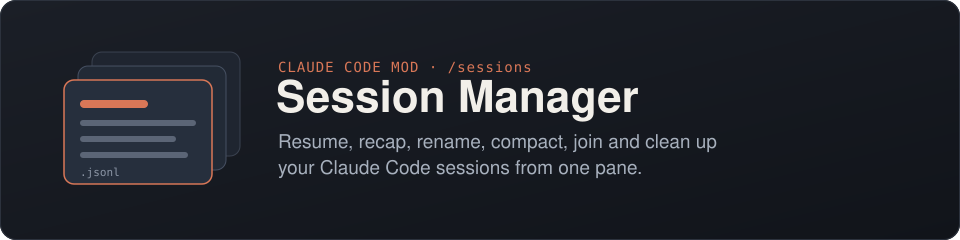
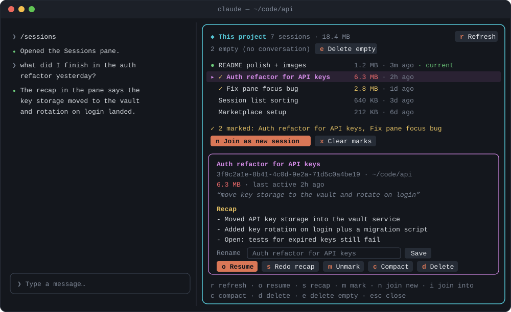
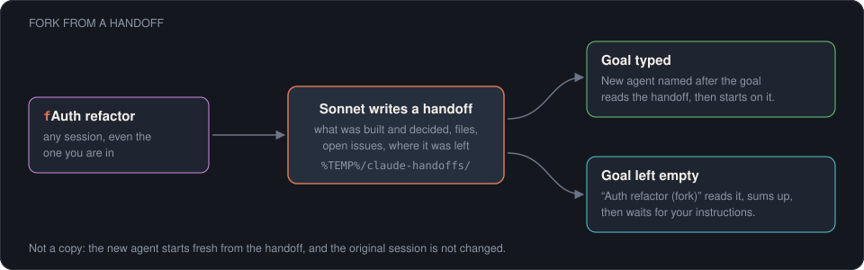
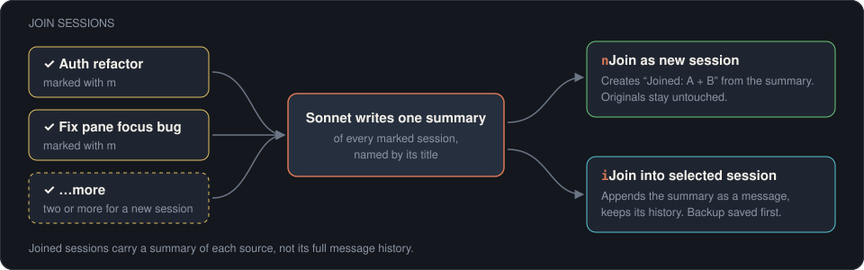

<div align="center">



<p>
  
  
  
  <a href="LICENSE"></a>
</p>

<p>
  <a href="#install">Install</a> ·
  <a href="#use">Use</a> ·
  <a href="#fork-from-a-handoff">Fork</a> ·
  <a href="#join-sessions">Join sessions</a> ·
  <a href="#how-it-works">How it works</a>
</p>

</div>

A Claude Code mod that adds a **Sessions** pane for browsing your saved sessions (the `.jsonl` transcripts under `~/.claude/projects`). From the pane you can resume any session (here or as a background agent), read a short recap of it, rename it, fork it into a new agent from a handoff, compact it like `/compact`, join several into one, or delete it.

<p align="center">
  
</p>

## Features

|  |  |
| --- | --- |
| ▶️ **Resume** | Jump into any session of the current project, same as `/resume`, or open it as a background agent. |
| 📝 **Recap** | A 3–5 line summary written by Haiku, cached until the session changes. |
| ✏️ **Rename** | Give a session one name, shown in both `/resume` and the agents view. |
| 🍴 **Fork** | Start a new background agent from a handoff of a session: give it a goal, or let it wait for your instructions. |
| 🗜️ **Compact** | Shrink a heavy session like `/compact`, without opening it. |
| 🔗 **Join** | Merge several sessions into a new one, or into an existing one. |
| 🧹 **Clean up** | Delete one session or the copies left by resuming open ones; empty sessions are removed automatically. |

Sizes are color-coded so heavy sessions stand out: **yellow** from 2 MB, **red** from 5 MB.

## Install

At the prompt of a Claude Code terminal session:

```
/plugin install session-manager --marketplace oskarinmix/claude-session-manager
```

Answer `y` to add the marketplace, then pick a scope (user scope loads it in every session).

<details>
<summary><b>From a shell</b></summary>

```
claude plugin install session-manager --marketplace oskarinmix/claude-session-manager
```

</details>

<details>
<summary><b>In the desktop app</b></summary>

`/plugin` doesn't run there. Click **+** next to the prompt box → **Plugins** → **Add marketplace** with `oskarinmix/claude-session-manager` → **Add plugin**.

</details>

<details>
<summary><b>From a local folder</b></summary>

Clone the repo, then either start a session with `claude --plugin-dir /path/to/claude-session-manager`, or add the folder to `CLAUDE_CODE_PLUGIN_DIRS` in the `env` block of `~/.claude/settings.json`:

```json
{ "env": { "CLAUDE_CODE_PLUGIN_DIRS": "/path/to/claude-session-manager" } }
```

</details>

### Requirements

- Claude Code with mod (function hooks) support. The side pane and mouse clicks need fullscreen mode (`/tui fullscreen`).
- **Node.js** on your `PATH`: the mod's file work runs in `scripts/sm.cjs`.

## Use

The pane opens by itself beside the chat when a session starts (in fullscreen mode on a wide enough terminal); **`/sessions`** opens it again after you close it. Click a row (or press Enter on it) to select a session.

#### Browse

| Key | Action |
| :---: | --- |
| <kbd>r</kbd> | Refresh the list |
| — | **⇣ compacted** mark: shown while the last thing in the session is a compaction (`/compact`, auto-compact or the pane's Compact). Once more is added it goes away; the details then say "compacted before, more added since". The file keeps the full history, Claude reads from the last summary on. The footer lists only the keys usable right now |
| <kbd>o</kbd> | **Open as agent**: opens the session as a new background agent (`claude --bg --resume`), same id, shown in the agents view. This window's session is left alone |
| <kbd>f</kbd> | **Fork**: opens a Goal box. The mod writes a handoff of the session (Sonnet) to `%TEMP%/claude-handoffs/` and starts a new background agent that reads it. With a goal, the agent (named after the goal) starts on it; with Enter on an empty box, the agent (`<name> (fork)`) replies with a short summary and waits for your instructions. Not a copy: the new session starts fresh from the handoff. Works on any session, including the current one |
| <kbd>h</kbd> | **Resume here**: closes the pane and opens the session in this window, same as `/resume` |
| <kbd>s</kbd> | **Recap**: 3–5 line summary of the session, written by Haiku and cached until the session changes |
| <kbd>Esc</kbd> | Close the pane |

#### Edit

| Key | Action |
| :---: | --- |
| Rename box | Saves the name for both `/resume` and the agents view. When a session starts or is resumed, a newer name from either place is copied to the other |
| <kbd>c</kbd> | **Compact**: Sonnet writes a full summary and appends a compact boundary, so resuming starts from the summary. A `.jsonl.bak` backup is saved first |

#### Join

| Key | Action |
| :---: | --- |
| <kbd>m</kbd> | **Mark to join**: ticks the selected session (✓). Press again to unmark |
| <kbd>n</kbd> | **Join as new session** (2+ marked): Sonnet writes one summary of all marked sessions and a new session is created from it, titled `Joined: …`. The originals stay untouched |
| <kbd>i</kbd> | **Join into** the selected session (select one that isn't marked): the summary of the marked sessions is appended to it as a message, keeping its own history. A `.jsonl.bak` backup is saved first |
| <kbd>x</kbd> | Clear marks |

#### Delete

| Key | Action |
| :---: | --- |
| <kbd>d</kbd> | **Delete**: asks to confirm, then removes the transcript, its backup and its sidecar folder |
| (auto) | **Empty sessions are deleted** each time the pane loads: sessions with no conversation (only a title, `/clear` or commands, left behind by restarts and `/clear`). The current session and any session open in a window or agent are kept |
| <kbd>p</kbd> | **Delete copies**: shown when the project has copies made by resuming a session while it was open elsewhere (marked `· copy`). Asks to confirm, and warns when a copy holds messages its original lacks. Copies open in a window and the current session are never included |

A session marked **open** is held by another Claude Code process (another window, or a background agent in the agents list). Claude Code forks a copy when you resume a session that is already open, so Resume, Compact and Delete are turned off for it. Switch to it where it runs instead. A session marked **copy** is such a fork; its details name the session it was copied from.

> [!WARNING]
> Deleting cannot be undone.

> [!NOTE]
> The current session is shown in green. Resume, Compact, Delete and Join into are disabled for it: use `/compact` and `/rename` there.

## Fork from a handoff

<p align="center">
  
</p>

Select a session, press <kbd>f</kbd>, and a **Goal** box opens with the cursor in it:

- **Type a goal** and press Enter: the handoff is written with that goal in mind, and the new agent, named after the goal, reads it and starts working.
- **Press Enter on an empty box**: the new agent, named `<session name> (fork)`, reads the handoff, replies with a short summary and waits. Open it in the agents view and tell it what to build.

The handoff is a Markdown file under `%TEMP%/claude-handoffs/` (your OS temp folder) covering what was built and decided, the files involved, open issues, where the work was left and which skills to use. The new session starts fresh from it, so a long conversation becomes a small, focused starting point. The original session is not changed.

## Join sessions

<p align="center">
  
</p>

Joined sessions carry a **summary** of each source, not its full message history.

> [!IMPORTANT]
> Recap, Fork, Compact and Join make model calls through your Claude Code login, so they count toward your usage.

## How it works

```
claude-session-manager/
├── hooks/index.tsx   the pane, the /sessions command and the model calls
└── scripts/sm.cjs    lists sessions, extracts transcripts, writes rename/compact/join rows,
                      creates joined sessions, saves handoffs and deletes files
```

`scripts/sm.cjs` refuses any path outside `~/.claude/projects` (or `$CLAUDE_CONFIG_DIR/projects`).

## License

[MIT](LICENSE)
